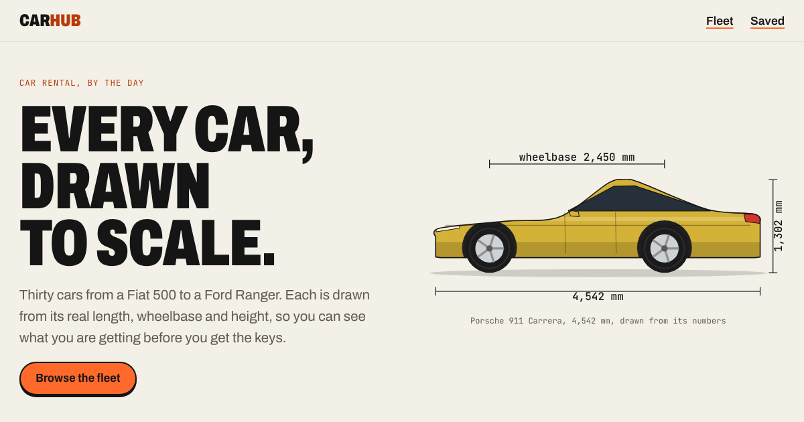

# CarHub

A car rental catalogue where every car is drawn to scale from its real measurements. Thirty cars, from a Fiat 500 to a Ford Ranger, each drawn in code from its own length, wheelbase, height, tyre size and ground clearance, all at one scale, so a Fiat 500 really is two thirds the size of a Ranger on the page.

Live: https://carhub-nextjs-1h3h.vercel.app/



CarHub is a demo: nothing can be booked and the prices are examples. The dimensions are each model's published figures, rounded.

Concept, design and code by Semperor.

## What is on it

- **The parade**: the whole fleet driving past bumper to bumper under the hero, at one scale with a 1 metre bar. Each wheel turns at the rate its own tyre would for the road speed, so small wheels spin faster than big ones.
- **The fleet**: search, filter by body, fuel, gearbox and seats, sort by price, size or power. Cards share one scale too.
- **Saved cars**: the heart on any car keeps it in the browser (localStorage); "Saved" in the header filters to them.
- **A page per car** (statically generated): a brochure-style drawing with length, wheelbase and height, the specifications, a price calculator with extras, a side-by-side with a car of a very different size, and similar cars.

## Run it

```bash
npm install
npm run dev                  # http://localhost:3000
npm run build && npm start   # production
```

## Where things live

| Path | What |
|---|---|
| `src/data/cars.ts` | The fleet: specs, measurements, paint, price per day. Add a car here and it gets a drawing, a card and a page. |
| `src/data/site.ts` | Every other visible string. Assumptions at the top. |
| `src/lib/drawing.ts` | The drawings. A silhouette per body type (hatch, sedan, wagon, SUV, coupe, roadster, pick-up, van), shaped by the car's own numbers and output as SVG in millimetres. |
| `src/components/CarArt.tsx` | Puts a drawing on the page at the site's one scale. In the parade the wheels are separate elements so they turn on the compositor. |
| `src/components/Parade.tsx` | The marquee of the fleet. |
| `src/components/Fleet.tsx` | Search, filters and sort. |
| `src/components/Booking.tsx` | The price calculator (days, extras, deposit). |
| `src/app/cars/[slug]/page.tsx` | The car page. |

Built with Next.js 16, React 19 and TypeScript, with no UI library and no API: the data ships with the site. Set in Archivo and JetBrains Mono, self-hosted.
